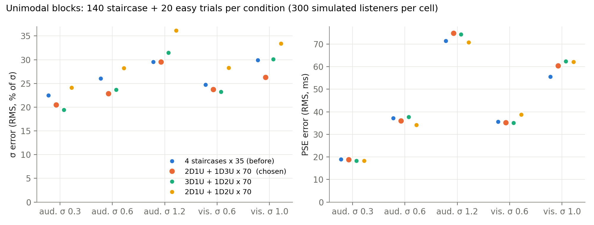
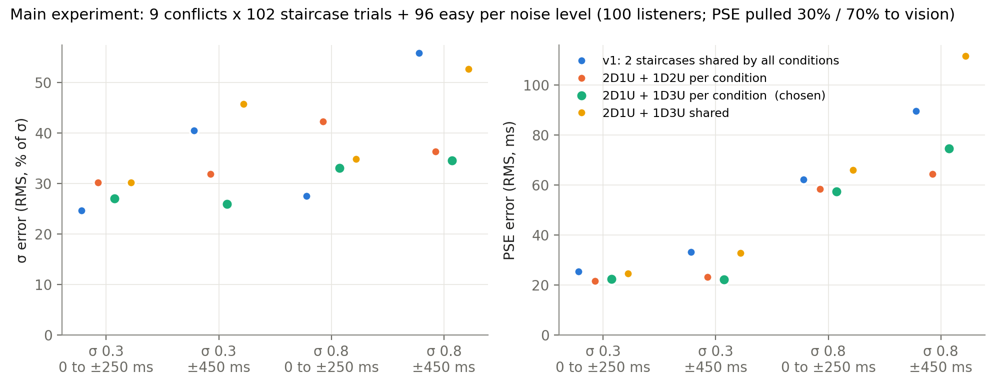
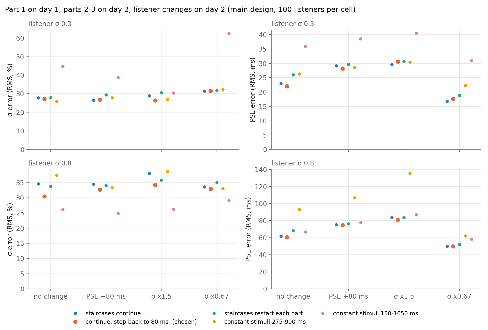
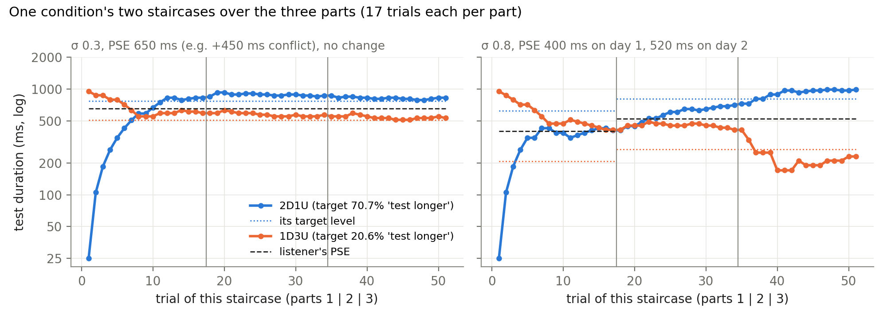

# AV duration v2 final design

> Final version of the v2 experiment, decided 6 Nov 2026. Simulations and figures are in `analysis/staircase_design_sims/`.

## Overview

- Task: 2IFC duration discrimination with a 500 ms standard.
- Session 1: unimodal auditory, unimodal visual, then main part 1.
- Session 2: main parts 2 and 3.

| Block | Trials | Approx. time |
| --- | --- | --- |
| Unimodal auditory | 330 | 17–23 min |
| Unimodal visual | 170 | 9–12 min |
| Main part 1 | 686 | 35–48 min |
| Main part 2 | 686 | 35–48 min |
| Main part 3 | 686 | 35–48 min |
| **Day 1 total** | 1186 | 60–80 min (+15–20 min instructions and breaks) |
| **Day 2 total** | 1372 | 70–95 min (+15–20 min instructions and breaks) |

Times are estimates from the trial timing (about 3–4 s per trial), not lab measurements.

## Warm-up

- Every block and every main part starts with 10 warm-up trials, dropped in the analysis:
  - 3 short and 3 long easy trials, in random order;
  - then 4 moderate trials (2 × 300 ms, 2 × 800 ms).
- No feedback. They never move a staircase, so the real staircases start on trial 11.
- They are saved, marked as warm-up, so the analysis drops them by that label.

## Unimodal blocks

- Auditory: 2 noise levels. Low noise is 0.1. High noise is fixed at 1.0 for everyone, with no calibration.
- Exclusion: a participant is excluded if their high-noise σ is above 2.9.
- Visual: 1 condition.
- Per condition:
  - 2 staircases of 70 trials each: 2D1U starting at 50 ms (the shortest test), and 1D3U starting at 950 ms.
  - 20 easy trials.
- Practice (20 trials with feedback) is optional.
- **Change from the earlier plan (4 staircases × 35):** two staircases measure σ at least as precisely (20–30% error) and the PSE about the same.

## Main experiment

- 2 noise levels × 9 conflicts (0, ±83, ±167, ±250, ±450 ms) = 18 conditions, all interleaved.
- Each condition has its own 2D1U and 1D3U staircase, so there are 36 staircases.
- 17 trials per staircase per part:
  - 51 trials per staircase over the three parts;
  - 102 trials per condition.
- 32 easy trials per noise level per part.
- 686 trials per part (676 + 10 warm-up).
- In parts 2 and 3, each staircase continues at the level where it stopped but goes back to the first step (80 ms).

### Staircases per condition, not v1's 2 shared staircases

| Design | σ error, low σ (0.3) | σ error, high σ (0.8) | PSE error at ±450, σ 0.3 |
| --- | --- | --- | --- |
| Shared (v1) | 25–41% | 28–56% | 33 ms |
| Per condition, 2D1U + 1D2U | 30–32% | 36–42% | 23 ms |
| **Per condition, 2D1U + 1D3U (chosen)** | 26–27% | 33–35% | 22 ms |

- Shared staircases are fine up to ±250 ms but miss the PSE at ±450 ms.
- 1D3U gives a better σ than 1D2U, with the same PSE.
- Each staircase reaches 8–15 reversals in its 51 trials, the first by trial 5–15.

## Change between days

I simulated part 1 on day 1 and parts 2–3 on day 2. On day 2 the simulated observer had either a PSE shift of +80 ms, σ × 1.5, or σ × 0.67.

- Every design loses about the same precision from pooling the two days.
- Restarting the staircases at each part is slightly worse everywhere.
- Going back to the first step improves σ when σ is large (31–34% vs 35–38% error) and changes nothing else.
- Drift is handled by checking afterwards (fits per day), not by the design.

## Why not constant stimuli

The alternative simulated was 7 fixed levels with about 120 trials per condition.

- It works only if the range matches the participant's σ.
- A narrow range (275–900 ms) fails at σ 0.8: PSE error of 93–193 ms.
- A wide range (150–1650 ms) fails at σ 0.3: σ error of 39–62%.
- σ differs between low and high noise, and the conflicts move the PSE, so one fixed set can't suit everyone.

## Durations

| | Shortest | Longest |
| --- | --- | --- |
| Staircases | 50 ms | 950 ms start for the staircases that begin at the top; 3000 ms safety cap |
| Easy trials | 50 ms (100 ms visual) | 2000 ms |

- Gaps are random on every trial:
  - pre 100–450 ms;
  - ISI 300–600 ms;
  - post 100–450 ms.
- In the main experiment the whole range shifts up when a long flash needs room. No gap is ever fixed.

## Data safety

- Every trial is written to disk immediately.
- A stopped part is rerun from its start; completed earlier parts are kept.

## Figures

### Figure 1: unimodal staircase designs

### Figure 2: shared vs per-condition staircases in main

### Figure 3: change between days and constant stimuli

### Figure 4: example staircases over the three parts

## Open questions for the PI

- [ ] σ_A and σ_V are measured on day 1 only, while parts 2–3 run on day 2. We could let σ differ per day in the model, or add a short unimodal check on day 2. Moving the visual block to day 2 would also balance the days to about 70–85 min each.
- [ ] Model and parameter recovery has not been rerun with the final design (±450, 102 per condition, 2D1U + 1D3U, step reset).
